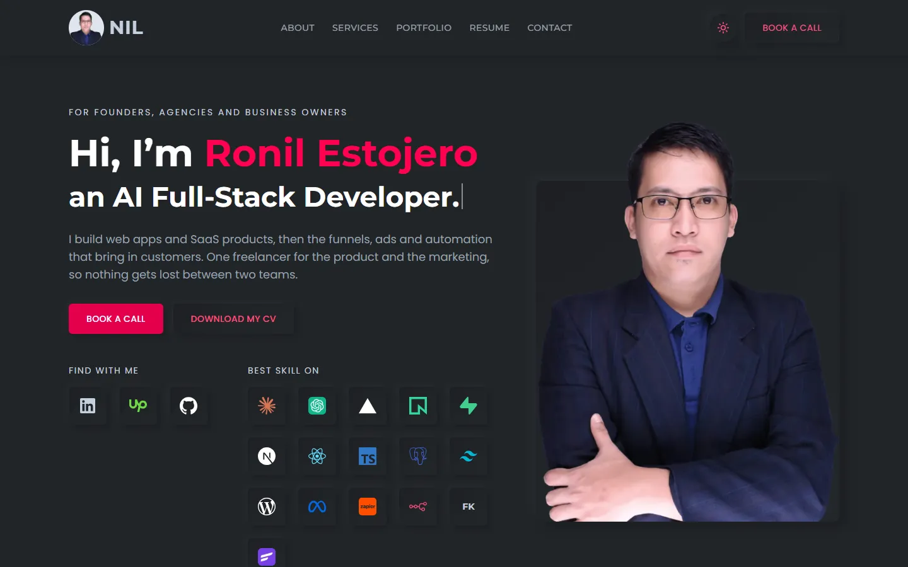

# Ronil Estojero · Portfolio

The portfolio of Ronil Estojero, a freelance full-stack developer, digital marketer and funnel builder. It includes a private dashboard where the owner edits every word and image on the site without touching code.

**Live:** [restojero.conexapro.io](https://restojero.conexapro.io)



## Features

- **One-page site** with hero, about, services, portfolio, resume and contact sections, in dark and light themes.
- **Project pop-ups** that open from shareable links such as `/#project-conexa-pro`, with large images that load as you scroll.
- **Dashboard** at `/dashboard` for editing all content. You can reorder lists, show or hide any section or item, and upload images.
- **Messages inbox** for the contact form, protected by Cloudflare Turnstile and an hourly limit.
- **CV as a PDF**, generated from the same content, so it always matches the site.
- **Pre-built public pages.** Visitors never wait on the database, and a save in the dashboard rebuilds the pages within seconds.

## Tech stack

| Area | Tools |
|---|---|
| Framework | Next.js 16 (App Router), React 19, TypeScript |
| Styling | Tailwind CSS 4, shadcn/ui, next-themes |
| Data | PostgreSQL on Neon, Prisma 7, zod |
| Auth | Clerk, limited to an allowlist |
| Files | Vercel Blob |
| Contact | Cloudflare Turnstile, optional Resend email |
| PDF | @react-pdf/renderer |
| Testing | Vitest, Playwright |
| Hosting | Vercel |

## How it works

- **Content is one validated document.** Every section lives in a single Postgres row, checked against a zod schema on every save and every read. With no database connected, the site falls back to the starter copy in `content/defaults.ts`.
- **Pages are static until a save.** Saving calls `revalidatePath`, which rebuilds the home page, its share image and the CV PDF. A failed database read never swaps in the starter copy: it fails loudly instead, so a build can't publish the wrong content.
- **Access is checked where the data is.** Every dashboard page, server action and upload route confirms the signed-in user is the owner. The proxy only makes the login session readable, and hidden items are removed on the server before anything reaches the browser.
- **Uploads go straight to storage.** The browser uploads images directly to Vercel Blob with a short-lived token. The server issues the token only to the owner, and it limits uploads to images under 8 MB, with no SVG.

## Project structure

```text
app/
  (site)/                  Public page and its layout
  (admin)/                 Dashboard and sign-in, the only routes that load Clerk
  api/upload/              Issues image upload tokens to the owner
  ronil-estojero-cv.pdf/   The CV, built from saved content
components/
  site/                    Public sections, header, footer, contact form
  dashboard/               Section editors, form fields, inbox
  theme/                   Theme provider and toggle
  ui/                      shadcn/ui primitives
content/defaults.ts        Starter content, used until something is saved
lib/
  auth/                    Owner check and page guard
  content/                 Schema, reads, saves, list helpers
  contact/                 Form handling, inbox, spam check
  cv/                      CV document and its URL
  db.ts                    Prisma client
prisma/                    Schema and migrations
scripts/seed-content.ts    Puts the starter content in an empty database
tests/                     Unit tests (Vitest)
e2e/                       Browser tests (Playwright)
proxy.ts                   Clerk session for dashboard routes only
```

## Getting started

You need Node.js 24.

```bash
npm install
npx vercel@latest link
npx vercel@latest env pull .env.local
npm run dev
```

The site runs at <http://localhost:3000>.

With `.env.local` pulled from Vercel, local and live share one database, so a save in the local dashboard changes the live content too. To work without touching real content, leave `DATABASE_URL` out of `.env.local`. The site then shows the starter copy, and the dashboard can't save.

A copy with no settings at all still builds and runs. It shows the starter copy, with no login and no contact form.

## Environment variables

Set these in Vercel and in `.env.local`. Never commit them. `.env.example` lists them all.

| Name | What it does |
|---|---|
| `DATABASE_URL`, `DATABASE_URL_UNPOOLED` | Neon connections for the site and for migrations |
| `CLERK_SECRET_KEY`, `NEXT_PUBLIC_CLERK_PUBLISHABLE_KEY` | Dashboard login |
| `ADMIN_EMAILS` | Comma-separated verified emails allowed into the dashboard. Empty means nobody. |
| `BLOB_READ_WRITE_TOKEN` | Image uploads |
| `NEXT_PUBLIC_TURNSTILE_SITE_KEY`, `TURNSTILE_SECRET_KEY` | Spam check on the contact form |
| `RESEND_API_KEY`, `RESEND_FROM_EMAIL`, `CONTACT_TO_EMAIL` | Optional: also email each message |
| `NEXT_PUBLIC_SITE_URL` | Optional: the site's address. Defaults to `https://restojero.conexapro.io`. |

The contact form appears when a database is connected, or when email and Turnstile are both set. Messages are capped at 30 an hour across the site, and email only goes out for a message that was saved or passed Turnstile.

## Scripts

| Command | Does |
|---|---|
| `npm run dev` | Starts the development server |
| `npm run build` | Builds for production |
| `npm run lint` | Runs ESLint |
| `npm run typecheck` | Generates route types and runs TypeScript |
| `npm test` | Runs the unit tests |
| `npm run e2e` | Runs the browser tests against a production build |
| `npm run db:migrate` | Applies database migrations |
| `npm run db:seed` | Saves the starter content to an empty database |

## Testing

The unit tests check the content rules, keep phone numbers and third-party contact details out of the site, and confirm that every save, upload and inbox action rejects anyone but the owner. They never touch the real database.

The browser tests run against a production build. They expect the starter copy, so build without the database first:

```bash
DATABASE_URL= npm run build
DATABASE_URL= npm run e2e
```

To test the spam check, build and test with Cloudflare's published always-pass Turnstile keys and any dummy `RESEND_API_KEY`, adding `E2E_CONFIGURED=1` to the test run.

## Database changes

Tables are defined in `prisma/schema.prisma`. After changing it, run `npx prisma migrate dev --name what-changed`. Deploys don't run migrations, so apply them with `npm run db:migrate` before pushing code that needs them.

Saved content is checked against `lib/content/schema.ts` on every read. Give any new required field a default, or reading older content will fail.

## Deployment

The project deploys to Vercel from this repository. Pushing to `main` deploys to production, and any other branch gets a private preview. Previews use the same database as production.

**Changing the domain:**

1. Add the domain in Vercel and set `NEXT_PUBLIC_SITE_URL`.
2. Create a Clerk production instance for the domain, replace the two Clerk keys, and add the owner's email to its allowlist.
3. Add the hostname to the Turnstile widget in Cloudflare.
4. Redeploy.
